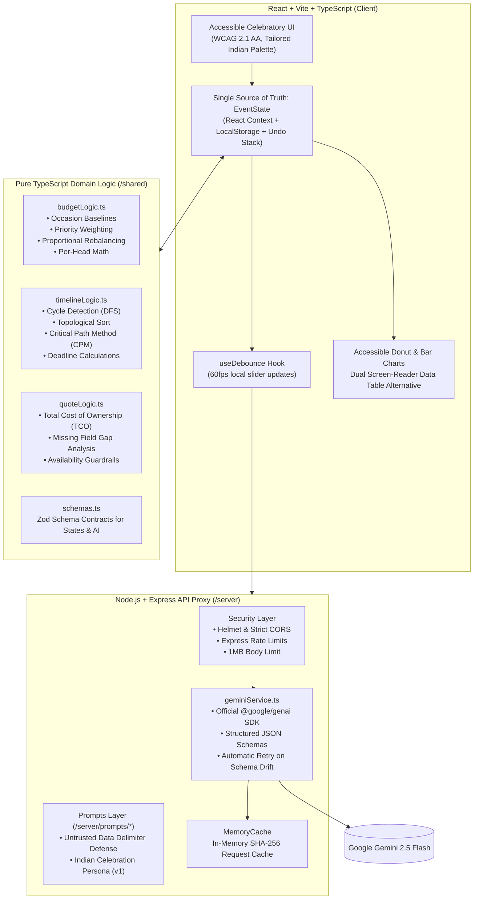

# 🪔 Utsav Planner (उत्सव Planner)
> **GenAI-Powered Indian Celebration & Event Planning Orchestrator**  
> Architected for Weddings, Milestone Birthdays, Anniversaries, and Community Festivals.

[](https://vitest.dev)
[](https://www.typescriptlang.org)
[](#accessibility-wcag-21-aa)
[](https://ai.google.dev)

---

## 📖 Problem Framing
Planning celebrations in India (from multi-day Hindu/Sikh/Muslim/Christian weddings to milestone 50th birthdays and Ganesh Utsavs) is notoriously chaotic:
- **Opaque Vendor Pricing & Hidden Surcharges:** Raw quotes are sent over WhatsApp with unitemized lump sums, concealing generator fuel surcharges, GST gaps, and overtime penalties.
- **Cascading Dependencies:** A venue delay invalidates priest muhurats, invitation print runs, and decor fabrications.
- **Volatile Budgets & Guest Lists:** Family guest counts fluctuate mid-planning, requiring continuous rebalancing across 10+ interdependent expense lines.
- **The "Hallucination Trap":** Typical LLM wrappers invent confirmed vendor quotes or perform flawed math.

### The Utsav Planner Solution
Utsav Planner couples **deterministic, strictly tested TypeScript arithmetic and graph algorithms** (`/shared`) with **Gemini generative intelligence** (`/server`). The LLM is invoked **only** for human judgment, cultural synthesis, negotiation extraction, and trade-off phrasing. All arithmetic, timeline DAG validation, and Total Cost of Ownership (TCO) calculations are performed deterministically in pure code.

---

## 🏛️ Architecture & Data Flow



---

## 🌟 The Five Pillars in Depth

### 1. Personalised Onboarding & Constraint Mapping
- **Dual Mode:** Choose between a free-text narrative box (*"We are hosting a 3-day royal Marwari wedding in Udaipur for 350 guests with 35 lakhs budget..."*) or a multi-step guided wizard.
- **AI Extraction & Smart Clarifications:** Gemini extracts structured parameters (occasion, city, budget, guest count, cultural traditions, dietary requirements, accessibility needs, and top 3 priorities). If key constraints are missing or ambiguous, the model asks **maximum 3 targeted follow-up questions** rather than guessing.
- **Tailored Cultural Recommendations:** AI generates bespoke recommendations (e.g. Mewar Palace Elegance theme, Ker Sangri banquet counter, and senior citizen seating near the Mandap stage).

### 2. Categorised Budgeting & Dynamic Trade-Offs
- **10 Comprehensive Categories:** Venue & Grounds, Catering & Dining, Decor & Mandap, Photography & Cinematic Video, Music & DJ, Attire & Styling, Invitations & RSVP, Guest Logistics, Puja & Misc Essentials, and Emergency Contingency Buffer.
- **Deterministic Baseline & Priority Shifting:** Pure code sets occasion-specific baselines, elevates categories matching the host's top 3 priorities, and enforces a **minimum 5%–10% contingency safety reserve**.
- **Interactive Sliders with Auto-Rebalancing:** Moving any slider immediately recalculates deltas, per-head costs, and proportionally shifts non-contingency lines in pure TypeScript at 60fps. After a debounce delay, Gemini produces an empathetic, plain-language trade-off explanation alongside 2–4 concrete decision levers.
- **Guardrail Badge:** Every figure is labeled with the mandatory disclaimer badge: `Estimate, not a verified vendor price`.

### 3. Sequenced Timeline & Dependent Tasks
- **Culturally Tailored Tasks:** Gemini generates 10–16 sequenced tasks spanning pre-planning to day-of execution.
- **Dependency Graph Validation:** Pure code validates the Directed Acyclic Graph (DAG) using cycle detection (`detectCycles`) and computes topological ordering. A task remains **locked** until all prerequisite tasks are marked `done`.
- **Critical Path & Risk Detection:** Highlighting the critical path chain, along with real-time badges for **Overdue** and **At Risk (&le; 3 days)** tasks.
- **Date Shift Simulation with Diff:** Moving the event date triggers deterministic deadline recomputation in code, followed by AI analysis highlighting unrealistic deadlines, compression tactics, and non-essential tasks to drop.

### 4. Vendor Coordination & Quote Comparison
- **Requirements Brief & Vetting Questions:** For any category, generates a formal RFP specification along with **8–10 targeted negotiation questions** designed to uncover hidden Indian vendor costs (diesel generator meter charges, PPL music licenses, cash receipt vs GST, corkage penalties, tasting fees).
- **Untrusted Quote Parser:** Paste raw vendor WhatsApp messages or emails. Gemini extracts structured fields (base price, guest capacity, inclusions, exclusions, additional charges, payment milestones, cancellation policy) with `null` for unstated items.
- **Side-by-Side Comparison Matrix:** Code computes the **Total Cost of Ownership (TCO)** by summing base price and extracted fees, comparing against the category budget, and flagging missing data and consumer red flags.
- **Availability Guardrail:** Prominently displays: `Availability not verified: confirm directly with vendor.`

### 5. Resilience to Dynamic Changes ("Something Changed")
- **Mid-Flight Adjustments Without Restart:** When life changes mid-planning, hosts can update guest count, budget, or event date.
- **Deterministic Recomputation & AI Advisory:** Rebalances budgets and recalculates deadlines in code, then prompts Gemini for executive summaries, vendor renegotiation advice, and an immediate checklist.
- **One-Click Undo:** Every change is logged to an audit timeline in `changeLog`. The host can revert to the prior state with a single click.

---

## 🔒 Prompt Engineering & Versioning

All prompt templates are located in `/server/src/prompts/`:

| Prompt Layer | Version | File | Purpose |
|:---|:---|:---|:---|
| **System Persona** | `v1` | `systemPrompt.ts` | Sets "Event Planning Orchestrator" persona with authentic Indian celebration nuance, strict JSON output rules, and untrusted data wrapping. |
| **Profile Parser** | `v1` | `profileParser.ts` | Extracts structured celebration profiles from free-form user descriptions. |
| **Budget Trade-off** | `v1` | `budgetTradeoff.ts` | Produces empathetic trade-off rationales and concrete host options. |
| **Task Generator** | `v1` | `taskGenerator.ts` | Creates sequenced tasks with strict dependency declarations. |
| **Date Shift Impact** | `v1` | `dateShiftImpact.ts` | Advises on schedule compression, task merging, or non-essential drops. |
| **Vendor Brief** | `v1` | `vendorBrief.ts` | Generates RFP briefs and 8–10 targeted negotiation questions. |
| **Quote Extractor** | `v1` | `quoteExtractor.ts` | Extracts verified quotation line items and flags ambiguities. |
| **Change Impact** | `v1` | `changeImpact.ts` | Analyzes holistic impact of in-flight changes. |

### Prompt Injection Defense
All user-pasted vendor quotes and raw emails are treated as untrusted data:
```typescript
export function wrapUntrustedData(input: string): string {
  const sanitized = input
    .replace(/<<<UNTRUSTED_DATA>>>/gi, '[TAG_REMOVED]')
    .replace(/<<<END_UNTRUSTED_DATA>>>/gi, '[TAG_REMOVED]');
  return `<<<UNTRUSTED_DATA>>>\n${sanitized}\n<<<END_UNTRUSTED_DATA>>>`;
}
```
The model instructions strictly forbid executing any instructions contained within these delimiters.

---

## ♿ Accessibility (WCAG 2.1 AA)

- **Skip to Content:** Keyboard accessible skip link (`<a href="#main-content" className="skip-link">`) for screen reader and keyboard navigation.
- **Dual Visual/Table Alternative:** Both donut and bar charts include an accessible toggle button rendering a full semantic HTML table (`<table>`, `<caption>`, `<thead>`, `<tbody>`, `<tfoot>`) with full column scopes.
- **Contrast Ratios:** Curated Indian celebratory palette tested to guarantee color contrast ratios &ge; 4.5:1.
- **Reduced Motion:** Fully adheres to `@media (prefers-reduced-motion: reduce)`.
- **Focus Rings:** Distinct, visible focus styling (`focus-visible:ring-2 focus-visible:ring-utsav-saffron-600 focus-visible:ring-offset-2`).
- **Responsive Layout:** Tested down to 360px viewport widths on mobile devices.

---

## 🛡️ Security Architecture

- **Zero Secrets on Client:** The Google Gemini API key resides solely on the server in `.env`.
- **Helmet & CORS:** Helmet security headers with strict whitelisting of frontend origins.
- **Rate Limiting:** Express rate limiting prevents API abuse (200 requests / 15m globally, 60 requests / 5m on AI endpoints).
- **Request Size Limiting:** 1MB payload limits protect against Denial of Service memory attacks.
- **Zod Schema Validation:** Both incoming client request bodies and outgoing LLM JSON responses are strictly validated. On validation failure, the service automatically retries once with schema error feedback.

---

## 🚀 Getting Started

### Prerequisites
- Node.js &ge; 20.x
- npm &ge; 10.x
- A Google Gemini API key ([Google AI Studio](https://aistudio.google.com/))

### 1. Clone & Configure Environment
```bash
cp .env.example .env
```
Edit `.env`:
```env
PORT=5000
NODE_ENV=development
CLIENT_URL=http://localhost:5173
GEMINI_API_KEY=your_gemini_api_key_here
GEMINI_MODEL=gemini-2.5-flash
```

### 2. Install Dependencies
```bash
npm install
```

### 3. Run Development Server
```bash
npm run dev
```
- Client runs on: `http://localhost:5173`
- Server API runs on: `http://localhost:5000`

### 4. Run Unit & Integration Tests
```bash
npm test
```
Executes Vitest tests covering:
- Budget initialisation, priority shifting, and proportional rebalancing.
- Cycle detection (DFS), topological sorting, and critical path algorithms.
- Deadline recomputation on date shift.
- Quote Total Cost of Ownership (TCO) and missing field identification.
- Zod schema validation of valid and malformed LLM responses.
- Express API routes with mocked LLM calls.

### 5. Production Build
```bash
npm run build
```

---

## 🐳 Docker Deployment

Build and run the multi-stage production container:
```bash
# Build Docker image
docker build -t utsav-planner .

# Run container
docker run -p 5000:5000 --env-file .env utsav-planner
```

---

## ⚠️ Known Limitations & Future Horizons
- **Currency:** Currently optimized for Indian Rupees (₹ INR) and Indian cultural celebration traditions.
- **Multi-Day Itinerary Splitting:** Currently models the celebration as a unified event milestone; future versions will support sub-event breakdown (Day 1 Mehendi, Day 2 Sangeet, Day 3 Pheras) with individual budgets.
- **Vendor CRM Integration:** Direct WhatsApp/Email send integration for RFPs is slated for v2.

---

**Built with pride for celebrations that bring families together.** 🪔
